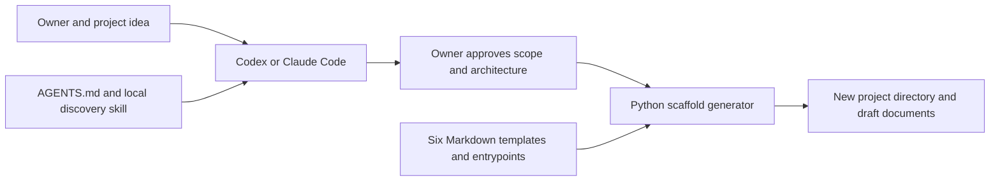

# AI Project Starter Agent

An approval-driven discovery workflow and Python scaffold generator for turning a software idea into a documented project. This is a reusable instruction toolkit for Codex and Claude Code, not a standalone autonomous agent service.

## Contributions and provenance

The existing Git history attributes the initial workflow, six document templates, agent entrypoints, and scaffold generator to Lucky John Faderon. This checkout preserves that history. These artifacts demonstrate requirements discovery, scope control, architecture planning, and reusable developer tooling; they do not establish production agent deployment experience.

## Technology and structure

Python 3 standard library (`argparse`, `pathlib`), Markdown, Codex/Claude Code instructions, and a local discovery skill. No third-party Python packages, database, web server, model SDK, or API credentials are required by the generator.

- `AGENTS.md`, `CLAUDE.md`: agent entrypoints and operating rules.
- `.agents/skills/start-project/SKILL.md`: staged discovery workflow.
- `docs/`: PRD, architecture, engineering rules, design, tasks, and durable memory templates.
- `scripts/new_project.py`: draft scaffold generator.

## Architecture



The host model follows instructions; the Python program only copies files and substitutes project name and idea. It does not call a model, select a technology stack, execute generated application code, or enforce conversational approvals itself.

## Features and verification

**Implemented and verified:** nine-file scaffold; project-name and idea substitution; refusal to overwrite an existing destination; rejection of empty names, `..`, and slash-containing paths. These behaviors passed a temporary-directory smoke check on Python 3.12.14 during portfolio preparation.

**Implemented but not fully tested:** the interactive discovery workflow and cross-host instruction following. Their effectiveness depends on the model, supplied context, and human review.

**Planned or experimental:** no application runtime or deployed agent service is included. Documents in `docs/` are templates, not accepted project decisions.

## Installation and setup

```bash
git clone https://github.com/dudezki/ai-project-starter-agent.git
cd ai-project-starter-agent
python3 scripts/new_project.py "Inventory AI" --idea "Inventory management for small companies" --output /tmp
```

Open the generated directory in Codex or Claude Code and say `Start a project`. Complete discovery and approve scope and architecture before implementation. To reuse manually, copy the entrypoints, `docs/`, and `.agents/skills/start-project/`. Remote GitHub instructions are not automatically loaded by either host.

## Engineering considerations

The generator resolves the output directory and refuses an existing project path. It has no network access logic, persistent background worker, credentials, telemetry, or dependency installation. Human approval gates live in the workflow instructions. Do not put secrets or customer data in discovery documents. There is no model evaluation suite, sandboxed tool executor, or automated authorization layer.

## Current status and limitations

Working scaffold utility and reusable discovery prototype. There is no separate compile/build step, hosted demo, screenshot, or production deployment. The generator is intended for trusted local input and does not provide transactional rollback if a copy fails. Personal contribution claims beyond the visible commit attribution require owner confirmation.
